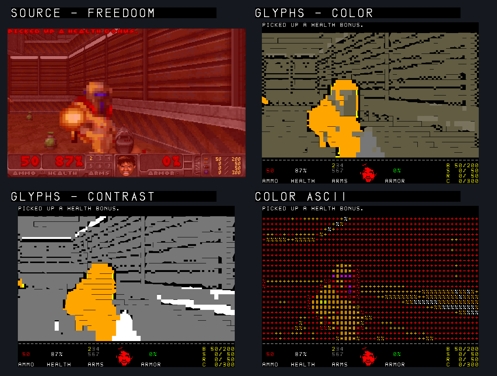

# MCDU DOOM

[Русская версия](README.ru.md) · [Running](docs/running.md) · [Gallery](docs/screenshots.md) · Packages

Play DOOM on the WINCTRL MCDU-32. The application combines the game,
standalone MCDU pages and a Windows tray menu. Use the emulator to play
without a physical panel.



The comparison shows the original Freedoom frame alongside color glyphs,
contrast glyphs and color ASCII. See the [gallery](docs/screenshots.md).

## Features

- Three rendering modes and display profiles up to 53 × 31 cells.
- MCDU MENU, INIT, PROG, PERF and RADIO NAV pages with aircraft fonts.
- L5 starts DOOM; MENU returns to the MCDU pages.
- The Windows tray menu selects the rendering mode, navigates between screens and stops the service.

## Quick start

See Packages for the Windows x64 build. Building from source
requires PowerShell 7, Rust 1.85 or later, MSVC C++ Build Tools and the Windows SDK.

```powershell
.\scripts\setup-freedoom.ps1
.\run.ps1
```

The first command downloads and verifies Freedoom 0.13.0. The second builds and
starts the tray application, which displays the MCDU menu on the panel.

Run the emulator without a panel:

```powershell
cargo run --locked -- emulate
```

Run a timed service session without windows or USB and save a capture:

```powershell
.\run.ps1 -NoTray -NoUsb -Seconds 3 -Capture output/service
```

Game data is stored separately. Supply another local IWAD with `--wad` in the CLI
or `-Wad` in the launcher. The service uses USB by default; `--no-usb` disables it.

## Documentation

| Task | Guide |
| --- | --- |
| Launch, controls and command options | [Running](docs/running.md) |
| Rendering modes and MCDU pages | [Gallery](docs/screenshots.md) |
| Display geometry, fonts and protocol | [Display capabilities](specs/MCDU-display-capabilities.md) |
| Grid and font diagnostics | [Static grid probe](docs/grid-probe.md) |
| Archive verification and offline builds | Packages |
| Code structure, tests and automation | [Architecture](docs/architecture.md), [Contributing](CONTRIBUTING.md) |

## Licensing

The host code is licensed under [GPL-3.0-only](LICENSE). See [NOTICE](NOTICE.md)
and [THIRD_PARTY](THIRD_PARTY.md) for attribution and component terms,
[image notices](docs/images/LICENSE.md) for screenshot provenance, and the
[license policy](LICENSE-POLICY.md) for distribution terms and open review items.
This project is independent of the panel and aircraft manufacturers.
