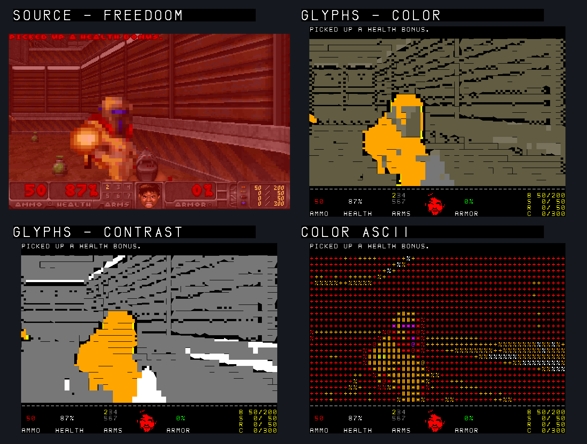

# MCDU DOOM

[English](README.md) · [Запуск и управление](docs/running.md) · [Галерея](docs/screenshots.md) · Пакеты

DOOM на дисплее WINCTRL MCDU-32! Приложение объединяет игру,
самостоятельные страницы MCDU и Windows-трей.



На изображении — исходный кадр Freedoom и три варианта его
отображения, реализованных программой.
[Все снимки и описание режимов](docs/screenshots.md).

## Возможности

- Три режима игрового вывода и профили дисплея до 53 × 31 ячейки.
- Страницы MCDU MENU, INIT, PROG, PERF и RADIO NAV с авиационными шрифтами.
- Запуск DOOM через L5 и возврат к MCDU клавишей MENU.
- Запуск в Windows-трей для выбора режима, навигации и завершения приложения.

## Быстрый запуск

Готовая Windows x64-сборка описана в руководстве пакетов.
Для сборки из исходников нужны PowerShell 7, Rust 1.85+ и MSVC C++ Build Tools
с Windows SDK.

```powershell
.\scripts\setup-freedoom.ps1
.\run.ps1
```

Скрипт устанавливает проверенный Freedoom 0.13.0, затем приложение запускается
в трее на авиационном меню. L5 включает DOOM, MENU возвращает страницы MCDU.
Выбор глифов, контраста и ASCII доступен в меню трея.

Запуск без панели:

```powershell
cargo run --locked -- emulate
```

Для проверки сервиса без окон и USB:

```powershell
.\run.ps1 -NoTray -NoUsb -Seconds 3 -Capture output/service
```

Игровые данные хранятся отдельно от приложения. Другой локальный IWAD задаётся
через `--wad` у CLI или `-Wad` у скрипта. Сервис использует USB по умолчанию;
параметр `--no-usb` отключает обращения к устройству.

## Документация

| Задача | Руководство |
| --- | --- |
| Запуск, управление, команды и параметры | [Работа с приложением](docs/running.md) |
| Режимы изображения и страницы MCDU | [Галерея](docs/screenshots.md) |
| Геометрия, шрифты и протокол дисплея | [Возможности дисплея](specs/MCDU-display-capabilities.md) |
| Проверка раскладки и загрузки шрифта | [Диагностическая сетка](docs/grid-probe.md) |
| Проверка архивов и офлайн-сборка | Пакеты |
| Устройство кода, тесты и CI | [Архитектура](docs/architecture.md), [CONTRIBUTING](CONTRIBUTING.md) |

## Лицензии

Код хоста распространяется под [GPL-3.0-only](LICENSE). Авторство и условия
сторонних компонентов приведены в [NOTICE](NOTICE.md) и [THIRD_PARTY](THIRD_PARTY.md).
Происхождение снимков описано в [уведомлении об изображениях](docs/images/LICENSE.md).
[Лицензионная политика](LICENSE-POLICY.md) содержит условия распространения
и ссылки на реестр открытых вопросов. Проект независимый и не является
официальным продуктом производителей панели или самолёта.
