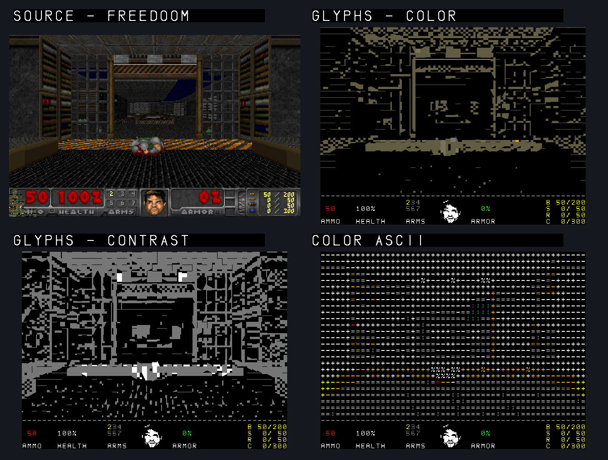
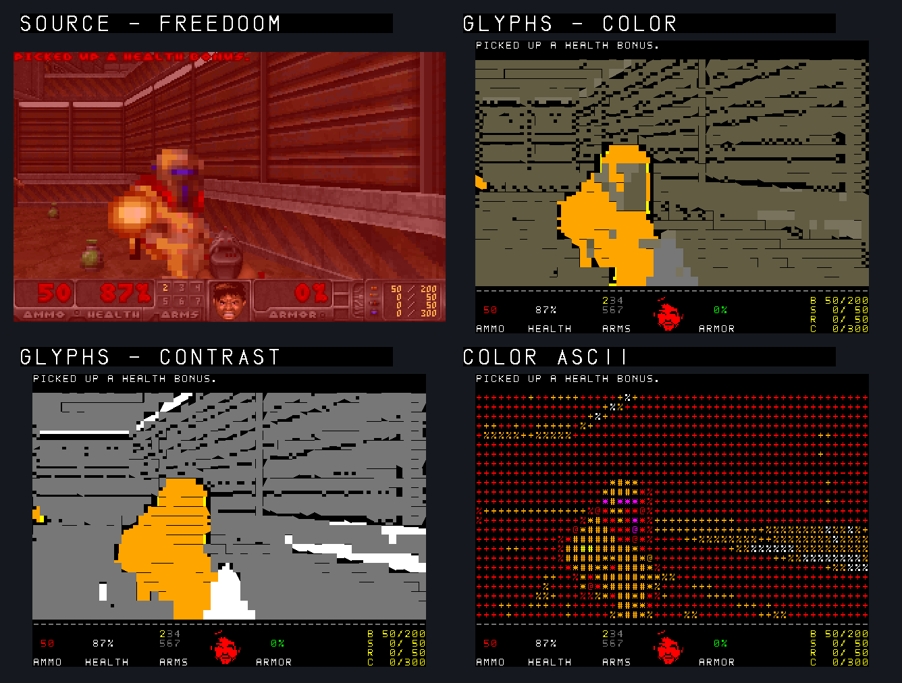
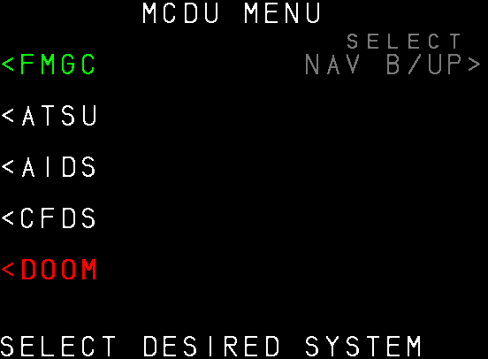
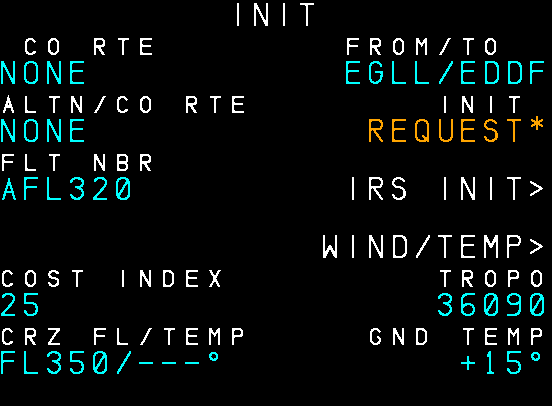
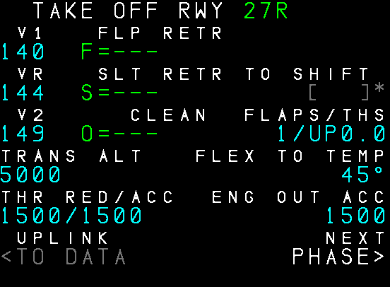
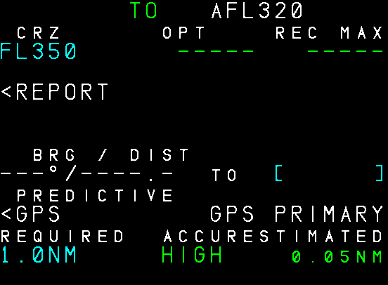
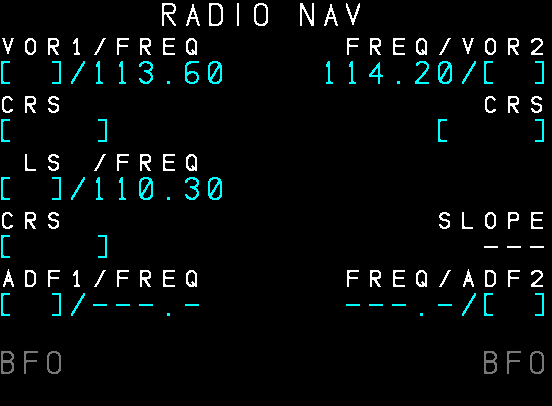

# Gallery

The images show software captures using Freedoom Phase 1 0.13.0.
See the [image notices](images/LICENSE.md) for attribution and terms.

## Game rendering modes





Each sheet uses one engine frame. The top row shows the original and color
glyphs; the bottom row shows contrast glyphs and color ASCII. The contrast mode
reduces background color and emphasizes visible enemies.

The 320 × 200 original is scaled by two. Glyph renderings are 583 × 434 pixels.
Captions and margins appear only on the comparison sheets.

## MCDU pages

| MCDU MENU | INIT |
| --- | --- |
|  |  |

| PERF | PROG |
| --- | --- |
|  |  |



Pages use a 24 × 14 grid and separate large and small
[aircraft fonts](../assets/aircraft-font/NOTICE.md).

## Reproduce the captures

```powershell
.\scripts\setup-freedoom.ps1
.\scripts\capture-readme.ps1
```

The capture script verifies the IWAD, runs `readme_gallery` without windows or
USB, and writes PNGs and their SHA-256 values. Use `-Out output/gallery` for a
separate destination. Frames and timings can vary between runs because the
engine runs in real time. Each comparison uses the same captured frame for all
four renderings.

[gallery.json](images/gallery.json) records frame metadata, timings and packet
counts. [image-hashes.json](images/image-hashes.json) lists the published PNG
checksums. Render timings measure software execution rather than LCD refresh.
